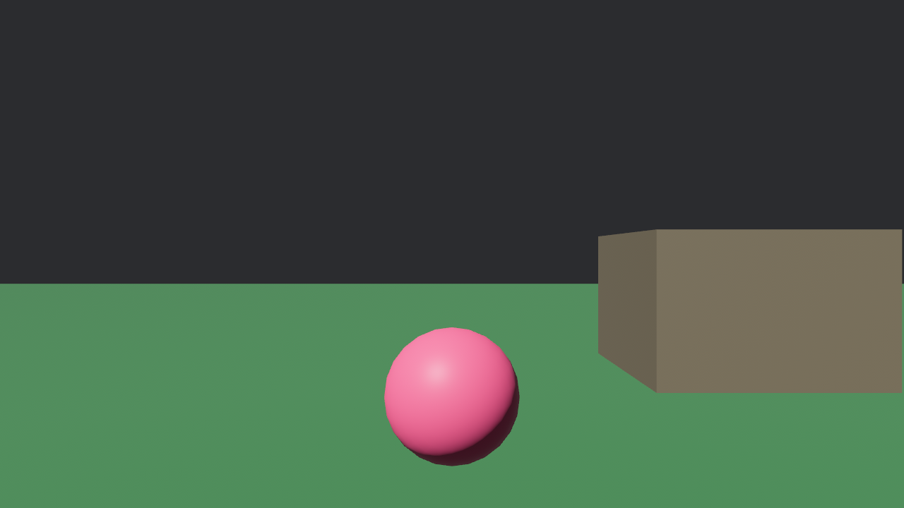

# SR2-NX

Native Switch research with a C++/libnx hardware probe and a preserved Rust/Bevy desktop reference. No original game code, assets, binaries, or dumps are included. This is not a completed Slime Rancher 2 port.



## Native Switch probe

Rust and Bevy are optional. The current native proof uses C++/libnx and OpenGL with procedural content. Build with `bash tools/build-native-probe.sh`; see [hardware instructions](docs/native-probe.md). Compilation and package checks passed; Switch rendering and controls await hardware testing. The full game's engine remains open.

## Desktop reference

Install Rust using rustup and a platform C linker (Visual Studio Build Tools with the C++ workload on Windows). The repository pins stable Rust 1.95.0 and Bevy 0.18.1.

```sh
cargo run --locked -p sr2-desktop
cargo fmt --all -- --check
cargo check --locked --workspace
cargo test --locked --workspace
```

Windows PowerShell uses these same commands in the repository directory. Native Windows execution must be tested on Windows; Linux results do not establish it.

Click to capture the mouse. WASD moves, mouse looks, Space jumps, hold left mouse to attract/capture the pink placeholder slime, right mouse releases one from inventory, Esc frees the mouse. Inventory is shown in the title bar. The floor, boundary, and cube have simple collision; this is not a general physics engine. Release places a slime ahead, without launch ballistics. Slime appearance and behavior are original placeholders.

`cargo run -p sr2-desktop -- --smoke` exits after 120 frames. See [test procedure](tests/README.md).

## Assets and Switch

See [asset workflow](docs/assets.md), [research](docs/research.md), [architecture](docs/architecture.md), [Switch feasibility](docs/switch-feasibility.md), and [current evidence](docs/progress.md). The desktop needs no proprietary content. `SR2_ASSET_DIR` points to a private converted-asset directory; `SR2_SCENE_FILE` optionally loads scene placements from JSON.

The optional Rust `sr2-switch` package has an experimental Horizon entry point and controller adapter using a pinned bevy-horizon revision. A host build of that package is only a diagnostic and exits unsuccessfully. Native builds require patched dependencies, libnx/devkitA64, Mesa NVK, and a separate nightly toolchain. No SR2-NX hardware performance or compatibility is verified.
